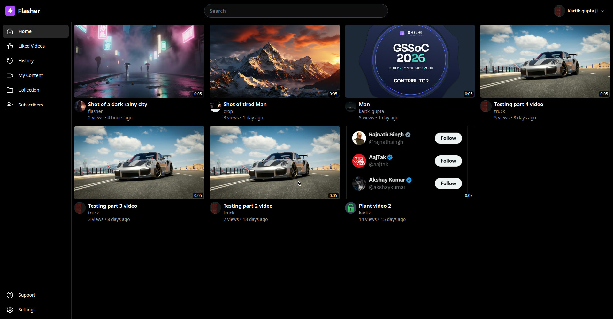
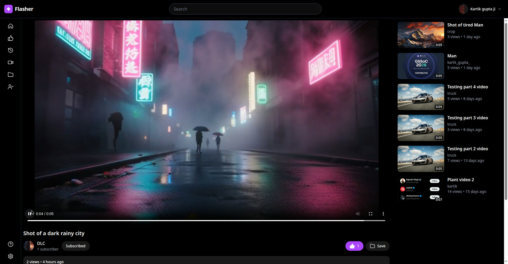
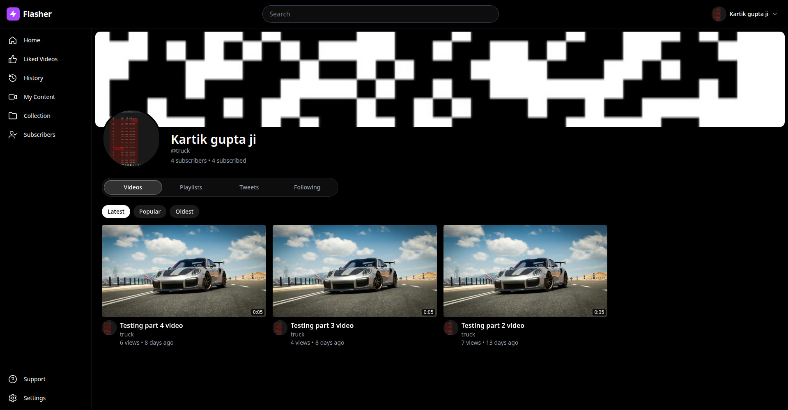
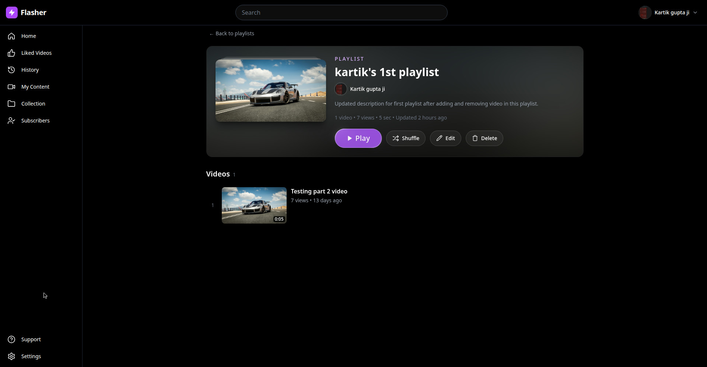
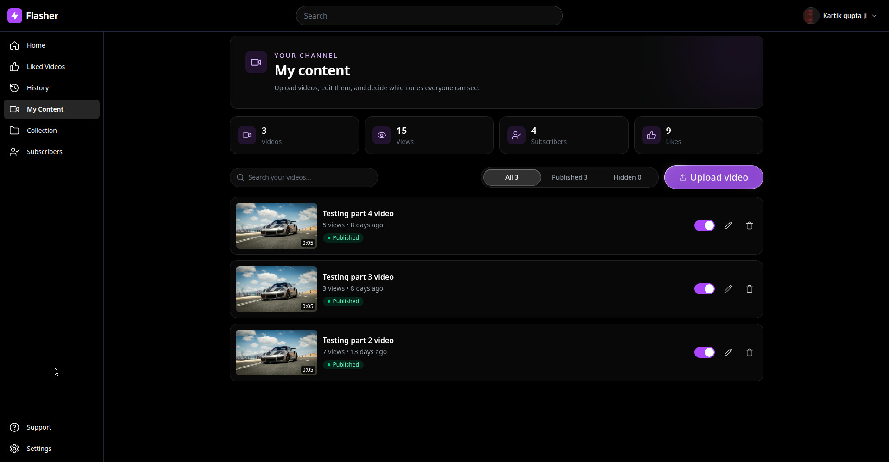

<p align="center">
  
</p>

<p align="center">
  A full-stack video sharing platform built with the MERN stack.<br/>
  <a href="https://flasherapp.me"><b>Live demo → flasherapp.me</b></a>
</p>



## Features

- **Auth:** register, login, logout with httpOnly cookies (access + refresh token) and automatic token refresh
- **Videos:** upload, edit, publish/unpublish, delete, search, infinite scroll
- **Engagement:** likes, comments, subscribe, tweets
- **Playlists:** create, edit, add/remove videos, save from the video page
- **Library:** liked videos, watch history, subscribers, collection
- **Channel page:** Videos, Playlists, Tweets and Following tabs
- **My content** dashboard and account settings

## Screenshots

| Video page | Channel page |
| --- | --- |
|  |  |

| Playlist | My content |
| --- | --- |
|  |  |

## Tech stack

| Layer | Tech |
| --- | --- |
| Frontend | React 19, Vite, Tailwind CSS 4, React Router, Axios |
| Backend | Node.js, Express 5, Mongoose |
| Database | MongoDB Atlas |
| Media | Cloudinary |
| Hosting | Render (one service: the backend also serves the built frontend) |

## Project structure

```
├── backend/    # Express API (controllers, models, routes, middlewares)
├── frontend/   # React app (pages, components, api, context)
├── docs/       # README screenshots and logo
└── README.md
```

## Run locally

```bash
git clone https://github.com/kg877253/flasher.git
cd flasher

# Backend (http://localhost:8000)
cd backend
cp .env.example .env     # fill in your values
npm install
npm run dev

# Frontend (http://localhost:5173), in a second terminal
cd frontend
npm install
npm run dev
```

The Vite dev server proxies `/api` to the backend.

### Environment variables (`backend/.env`)

| Variable | Description |
| --- | --- |
| `MONGODB_URI` | MongoDB Atlas connection string |
| `ACCESS_TOKEN_SECRET`, `REFRESH_TOKEN_SECRET` | JWT secrets |
| `ACCESS_TOKEN_EXPIRY`, `REFRESH_TOKEN_EXPIRY` | e.g. `1d`, `10d` |
| `CLOUDINARY_CLOUD_NAME`, `CLOUDINARY_API_KEY`, `CLOUDINARY_API_SECRET` | Cloudinary credentials |
| `CORS_ORIGIN` | Frontend origin (`http://localhost:5173` in dev) |

## Deployment

Build the frontend (`npm run build` in `frontend`), then start the backend with `NODE_ENV=production`. It serves `frontend/dist` and the API from the same origin.

## Author

**Kartik Gupta** · [GitHub](https://github.com/kg877253) · [LinkedIn](https://linkedin.com/in/kartik-gupta-a5073733a)
